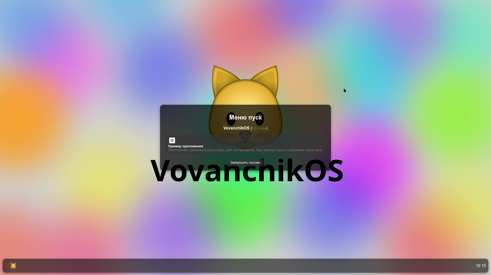

# VovanchikOS
> [!WARNING]
> Эта версия проекта азаброшена, так как сам проект переходит на другой UI - Bootstrap на Electron



**VovanchikOS** — операционная система, разработанная с использованием **Electron** и **Node.js**. Она предлагает уникальный опыт с графическим интерфейсом, построенным с использованием **HTML**, **CSS** и **JavaScript**.

## ВНИМАНИЕ

Этот проект находится на стадии **разработки** и **бета-тестирования**. На текущий момент система может быть нестабильной и содержать ошибки. Однако, если вам интересно, вы можете помочь в развитии проекта:

- **Поддержите проект**, сделав форк репозитория.
- **Внесите изменения** и создайте пулл-реквест, чтобы улучшить систему.

## 🚧 TODO

- ✅ **Добавить время на панель задач**
- ❌ **Реализовать меню "Пуск"** (13%)
- ❌ **Создать менеджер окон**
- ❌ **Завершить разработку рабочего стола**
- ❌ **Сделать установщик** (4%)

## Установка

1. Клонируйте репозиторий:
   ```bash
   git clone https://github.com/ImVovanchik/vovanchikos.git
   ```

2. Перейдите в директорию проекта:
   ```bash
   cd vovanchikos
   ```

3. Установите зависимости:
   ```bash
   npm install
   ```

4. Запустите приложение:
   ```bash
   npm start
   ```

## Вклад в проект

Если вы хотите внести изменения в проект, пожалуйста, следуйте этим шагам:

1. Сделайте форк репозитория.
2. Создайте новую ветку:
   ```bash
   git checkout -b feature-name
   ```
3. Внесите изменения и сделайте коммит:
   ```bash
   git commit -m "Описание изменений"
   ```
4. Отправьте изменения в ваш форк:
   ```bash
   git push origin feature-name
   ```
5. Создайте пулл-реквест, чтобы предложить изменения.
